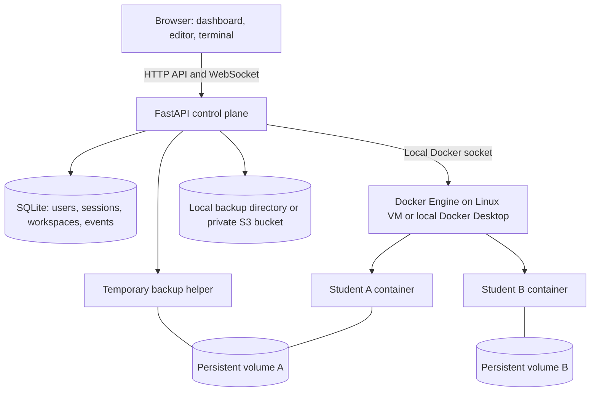
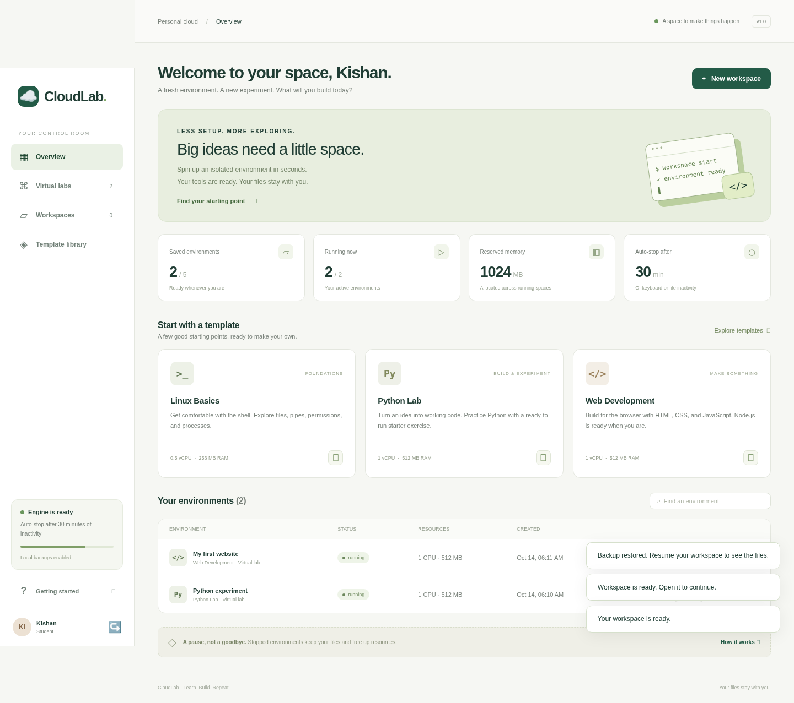

# CloudLab

**A cloud-based virtual lab and development workspace platform.**

CloudLab combines the two ideas from the project discussion: an on-demand virtual lab for guided learning, and a persistent development workspace for personal projects. A student signs in, chooses a template, and opens a real isolated Linux container through a browser editor and terminal.

This repository contains the working application, Docker runtime, tests, and deployment instructions. It uses **container-based virtualisation**. Each student environment shares the host's Linux kernel; it is not a separate virtual machine or hypervisor implementation.

## Contents

- [What you can do](#what-you-can-do)
- [Run it on your laptop](#run-it-on-your-laptop)
- [Use the application](#use-the-application)
- [Understand the architecture](#understand-the-architecture)
- [Understand the source code](#understand-the-source-code)
- [Configuration](#configuration)
- [Development and testing](#development-and-testing)
- [Cloud deployment and S3 backups](#cloud-deployment-and-s3-backups)
- [Limits and design decisions](#limits-and-design-decisions)
- [Troubleshooting](#troubleshooting)

## What you can do

| Feature | Implementation |
| --- | --- |
| Student accounts | Registration, sign-in, sign-out, hashed passwords, persistent sessions |
| Administrator account | View users, all environments, and recent activity; manage workspaces |
| Two modes | Guided virtual labs with a checklist, or development workspaces |
| Three templates | Linux Basics, Python Lab, and Web Development |
| Workspace lifecycle | Create, open, stop, resume, and delete |
| Browser editor | Explore, create, edit, save, and delete UTF-8 text files |
| Interactive terminal | Real Bash PTY through authenticated WebSockets and xterm.js |
| Run starter code | Run Linux/Python/Node starter programs in the terminal |
| Web preview | HTML with local CSS and classic JavaScript, in a sandboxed iframe |
| Persistent files | A separate Docker named volume for each workspace |
| Backups | Create, list, download, restore, and delete `.tar.gz` snapshots |
| Cloud storage | Optional private S3 bucket, using boto3 |
| Resource management | CPU, RAM, process, per-user workspace, and server running limits |
| Idle shutdown | Stops environments after configurable inactivity |
| Observability | Live CPU/RAM metrics and an administrator event log |
| Repeatable setup | Docker Compose, environment example, local development script, CI |

### Templates

| Template | Starter | Run command | CPU limit | RAM limit |
| --- | --- | --- | --- | --- |
| Linux Basics | `hello.sh` | `bash hello.sh` | 0.5 CPU | 256 MiB |
| Python Lab | `main.py` | `python main.py` | 1 CPU | 512 MiB |
| Web Development | `index.html`, CSS, JS, `main.js` | `node main.js` | 1 CPU | 512 MiB |

All three use the same prebuilt image with Bash, Python 3.12, Node.js 22, and npm. Templates supply different starter files, resource allowances, and lab instructions. No Python/Node installation is needed on a student's laptop.

## Run it on your laptop

### Requirements

- Docker Engine with Docker Compose v2 on Linux, or Docker Desktop on macOS/Windows using **Linux containers**.
- About 4 GB of available RAM for a small demo; 8 GB is more comfortable.
- Internet access during image builds. After building, local labs work without internet access.
- Git to clone the repository, or extract the provided project archive.

On Windows, run the shell commands in WSL2 or Git Bash. On macOS, Docker Desktop supplies the Linux VM where containers actually run.

### 1. Open the project and create your configuration

```bash
git clone https://github.com/kishann-19/on-demand_workspace-virtualisation.git
cd on-demand_workspace-virtualisation
cp .env.example .env
```

If using the project archive or an existing checkout, open that directory and run only the `cp` command.

Edit `.env` and set an administrator email and your own password:

```dotenv
ADMIN_EMAIL=admin@example.com
ADMIN_PASSWORD='replace-with-your-own-long-password'
```

Use at least 10 characters. Single quotes in a dotenv file preserve characters such as `$`. There are no built-in login credentials. Leave these fields empty if you only need student accounts initially.

### 2. Build and start

```bash
docker build -t cloudlab-workspace:local runtime
docker compose up --build -d
```

The first command builds the image students will use. The second builds and starts the management application. These are different images because the application needs Docker control, while student environments must not have it.

### 3. Open the application

Visit **[http://localhost:8000](http://localhost:8000)**.

- Sign in with the administrator account from `.env`.
- Or select **Create an account** to register a student.
- Create a Python Lab and open it. Run `python main.py` in the terminal.

Use exactly the hostname in `APP_ORIGIN`. If you prefer `http://127.0.0.1:8000`, set that value in `.env` and recreate the API container. This check protects browser requests and terminal connections.

### Stop and start the application

```bash
docker compose stop
docker compose start
docker compose logs -f api
```

**Stop student workspaces from the dashboard before shutting down the API.** Their containers are managed independently of Compose. While the API is stopped, its idle cleanup task cannot run.

`docker compose down` removes the API container/network but keeps its named data volume. **Do not add `-v` unless you intend to delete the application database and local backups.** Workspace volumes are separate and should be deleted through the dashboard, which also updates the database.

### Create an admin later or reset a password

These commands prompt for a new password without placing it in shell history:

```bash
docker compose exec api python scripts/manage.py create-admin you@example.com
docker compose exec api python scripts/manage.py reset-password you@example.com
```

`create-admin` creates a new administrator or promotes an existing account and sets its password. `reset-password` changes an existing account's password. Both revoke that user's sessions. Bootstrap environment variables only create a missing account; changing `ADMIN_PASSWORD` later does not reset an existing password.

## Use the application

### A complete workflow

1. **Create:** Select **New workspace**, give it a name, choose a mode and template, and launch.
2. **Open:** Select **Open** to enter the editor. Virtual Lab mode also shows guided tasks.
3. **Edit:** Choose a file, make a change, and click **Save file**, or press `Ctrl+S` / `Cmd+S`.
4. **Run:** Use **Run** for the template's starter command. For other files, type the command in the terminal.
5. **Explore:** Use `+` to create a file, including subdirectories such as `src/example.py`. Refresh the explorer after creating files in the terminal.
6. **Preview:** In a Web Development workspace, save your files and click **Preview**. It uses `index.html` and its local stylesheets and scripts.
7. **Pause:** Return to Overview and stop the workspace. Files in `/workspace` remain saved, while running processes stop.
8. **Back up:** Open the workspace's download-arrow action and create a backup while it is stopped.
9. **Resume:** Select **Resume**, then **Open**. Your saved files are still there.
10. **Restore:** Stop the workspace and restore a backup. This replaces its current files with the snapshot.
11. **Delete:** Deleting a workspace permanently removes its container, volume, backup objects, and metadata after confirmation.

Lab checkboxes are a personal checklist stored in that browser's local storage. They are not grades or server-side submissions.

### What counts as activity?

Terminal input and saving/deleting files reset `last_active`. Reading files, metrics polling, and leaving a browser tab open do not. The idle worker checks every 30 seconds. After the configured idle interval, it stops the entire container, including long-running programs. Save changes before stepping away.

## Understand the architecture



### Where virtualisation happens

Docker creates a Linux container for every environment. Linux namespaces provide process/filesystem/network separation. Cgroups impose CPU, memory, and process limits. Each container runs as UID 1000, with a read-only root filesystem, no Linux capabilities, no network interface beyond loopback, and a writable volume at `/workspace`.

The Docker socket is mounted **only into the control-plane API container**. A learner's terminal runs inside their own container. It does not execute shell commands on the server host.

### Where cloud computing happens

On a cloud deployment, a Linux VM supplies compute and runs Docker. The API provisions environments on demand. A private S3 bucket stores backup objects outside that VM. You can demonstrate the same software locally first, then deploy it to AWS EC2, Azure, GCP, or another Linux VM provider.

Local backup mode is fully functional but stores files on the server. **Local backups alone do not demonstrate remote cloud storage.** Enable S3 to demonstrate that part of the project. No cloud resources are created automatically by this repository.

### Example: creating a Python Lab

1. The browser sends `POST /api/workspaces` with a name, `python` template, and mode.
2. The API verifies the session cookie and CSRF token.
3. The service checks per-user and server quotas while holding its lifecycle lock.
4. Docker creates a named volume and starts a constrained container using the configured image.
5. The API writes starter files through a small Python helper **inside the container**.
6. SQLite records the owner, template, resource limits, status, and activity time.
7. Opening the editor loads the files and opens an authenticated WebSocket.
8. Terminal keystrokes are forwarded to a Docker exec PTY; output flows back to xterm.js.

### Data persistence

| Data | Location | Survives API/container restart? |
| --- | --- | --- |
| Users, password hashes, sessions, workspace metadata, event log | SQLite in `cloudlab-data` Compose volume | Yes |
| Workspace files | `cloudlab-<workspace-id>` Docker named volume | Yes |
| Local backups | `/app/data/backups` in API data volume | Yes |
| S3 backups | Configured private bucket, under `cloudlab/` | Yes, also independent of VM storage |
| Unsaved editor text | Browser memory | No |
| `/tmp` files and running processes | Workspace runtime | Not persistent project state |

Backups are file archives, not VM snapshots. They do not preserve RAM, a running process, installed image layers, or application accounts. Back up the API data volume separately for disaster recovery.

## Understand the source code

```text
app/
  main.py          HTTP routes, validation, WebSocket terminal, security headers
  auth.py          Password hashing, cookies, sessions, CSRF, role checks
  config.py        Environment variables and resource limits
  db.py            SQLite tables and connection helpers
  service.py       Lifecycle, quotas, activity, backups, audit events
  runtime.py       Docker containers, exec, volumes, PTY, and metrics
  storage.py       Local disk and S3 backup adapter
  preview.py       Inlines local CSS/JS for sandboxed static previews
  templates.py     Three starter environments and guided tasks
  static/          Browser UI, CSS, JavaScript, and vendored xterm.js
runtime/
  Dockerfile       The image used by learner environments
  agent.py         Validated file and archive operations inside containers
scripts/
  dev.sh           Local Python development setup
  manage.py        Administrator creation and password reset
tests/             API, isolation, archive, S3 contract, and Docker tests
docs/
  deployment.md    Linux VM, HTTPS, S3, and operations
  demo.md          Demo script, explanation, and viva questions
Dockerfile         API application image
compose.yaml       API container and persistent application volume
.env.example       Configuration template
```

**Suggested reading order:** `templates.py` → `config.py` → `db.py` → `auth.py` → `service.py` → `runtime.py` → `main.py` → `static/app.js`. This goes from the data model to orchestration and then the user interface.

Main database relationships: one user owns many workspaces; one workspace has many backups; one user has many sessions. Audit events retain IDs after workspace deletion so the administrative record remains readable.

### Important API endpoints

| Method | Path | Purpose |
| --- | --- | --- |
| POST | `/api/auth/register`, `/api/auth/login`, `/api/auth/logout` | Authentication |
| GET | `/api/auth/me` | Current user and CSRF token |
| GET | `/api/templates`, `/api/system` | Templates and runtime readiness |
| GET / POST | `/api/workspaces` | List own environments / create one |
| POST | `/api/workspaces/{id}/start` or `/stop` | Resume or stop |
| DELETE | `/api/workspaces/{id}` | Delete environment and its backups |
| GET | `/api/workspaces/{id}/files` | List editable files |
| GET / PUT / DELETE | `/api/workspaces/{id}/file` | Read, save, or delete a file |
| WebSocket | `/api/workspaces/{id}/terminal` | Interactive terminal |
| GET | `/api/workspaces/{id}/metrics` or `/preview` | Resource usage / static preview |
| GET / POST | `/api/workspaces/{id}/backups` | List / create snapshots |
| POST | `/api/workspaces/{id}/backups/{backupId}/restore` | Restore a snapshot |
| GET | `/api/workspaces/{id}/backups/{backupId}/download` | Download a snapshot |
| DELETE | `/api/workspaces/{id}/backups/{backupId}` | Delete a snapshot |
| GET | `/api/admin/overview` | Users, all workspaces, and activity |
| GET | `/api/health` | API process liveness; Docker readiness is in `/api/system` |

The OpenAPI schema is available at `/openapi.json`. Non-GET authenticated requests must include `X-CSRF-Token` from the login/me response, alongside the session cookie. The socket requires the exact configured Origin and a first JSON message containing `csrf`. The application vendors browser assets and does not depend on a CDN to load the dashboard.

## Configuration

| Variable | Default | Meaning |
| --- | --- | --- |
| `APP_ORIGIN` | `http://localhost:8000` | Exact public browser origin, without a trailing slash |
| `SECURE_COOKIES` | `false` | Set `true` when serving over HTTPS |
| `ALLOW_REGISTRATION` | `true` | Whether students may create accounts |
| `DATA_DIR` | `data` for local Python; `/app/data` in Compose | SQLite and local backups |
| `WORKSPACE_IMAGE` | `cloudlab-workspace:local` | Prebuilt runtime image |
| `DOCKER_HOST` | `unix:///var/run/docker.sock` | Local Docker Engine API socket |
| `IDLE_TIMEOUT_MINUTES` | `30` | Time without activity before automatic stop |
| `MAX_WORKSPACES_PER_USER` | `5` | Running and stopped workspaces combined |
| `MAX_RUNNING_PER_USER` | `2` | Simultaneously running environments per owner |
| `MAX_HOST_RUNNING` | `10` | Running environments across the server |
| `ADMIN_EMAIL`, `ADMIN_PASSWORD` | empty | Optional initial administrator |
| `S3_BUCKET` | empty | Private backup bucket; empty selects local storage |
| `AWS_DEFAULT_REGION` | from AWS SDK configuration | Bucket region |
| `S3_ENDPOINT_URL` | empty | Optional compatible S3 endpoint |

AWS credentials use boto3's standard credential chain. Prefer a VM IAM role. Never put AWS keys in frontend JavaScript or commit `.env`. Keep the same bucket configured for existing S3 backup records; the database tracks object keys and backend type, not bucket migration history.

After changing `.env` for Compose, run `docker compose up -d --force-recreate`. Template CPU/RAM allocations are defined in `app/templates.py`; changing them affects new environments.

## Development and testing

For local Python development, install Python 3.12+ and keep Docker running:

```bash
cp .env.example .env
./scripts/dev.sh
```

The script creates `.venv`, installs dependencies, builds the runtime image, and runs the API with reload. It overrides `DATA_DIR` to `./data` so your host does not need an `/app` directory. It still requires the Docker daemon; the application never silently replaces real containers with simulated workspaces.

Manual equivalent:

```bash
python3 -m venv .venv
source .venv/bin/activate
pip install -r requirements-dev.txt
docker build -t cloudlab-workspace:local runtime
DATA_DIR="$PWD/data" uvicorn app.main:create_app --factory --env-file .env --reload
```

Tests:

```bash
.venv/bin/pytest -q
RUN_DOCKER_TESTS=1 .venv/bin/pytest -q -m docker
.venv/bin/ruff check app runtime scripts tests
node --check app/static/app.js
```

The default suite runs without Docker and checks authentication, CSRF, permissions, quotas, idle shutdown, backups, and archive traversal protection. The opt-in Docker tests execute all three templates, verify actual container restrictions, exercise persistent volumes and restoration, and run a command over a WebSocket terminal. GitHub Actions runs both groups.

The S3 adapter has a boto3 Stubber contract test with no network access. Live S3 verification needs your own bucket and credentials. Browser checks cover account flow, environment creation, editing, terminal execution, backup actions, preview, and responsive layout; the reusable script is `scripts/browser_smoke.py`.

To repeat the browser check against a running local server:

```bash
.venv/bin/pip install playwright==1.63.0
.venv/bin/playwright install chromium
.venv/bin/python scripts/browser_smoke.py --url http://localhost:8000
```

Or pass `--browser /usr/bin/chromium` to use an existing Chromium installation. The check creates a test student account and deletes its test workspaces afterwards. Screenshots go to the ignored `test-results/` directory.

### Verification of this implementation

The combined test run passed **24 tests**, including the four tests using real Docker containers. The browser smoke check passed registration, creation, editing, terminal execution, stop/resume, backup/restore, interactive web preview, and a 390-pixel mobile layout, with no JavaScript errors. The API and runtime Docker images both built successfully. These results validate the local implementation; they do not assert a live AWS deployment or live S3 credentials.



## Cloud deployment and S3 backups

Follow **[docs/deployment.md](docs/deployment.md)** for the VM, reverse proxy, TLS, S3 permissions, and backup procedures. Follow **[docs/demo.md](docs/demo.md)** for a presentation and viva explanation.

## Limits and design decisions

- This is a complete **single-server educational project**, intended for a controlled lab or trusted users. Containers share a kernel; the Docker-enabled control plane is privileged. A hostile public code-execution service needs a stronger isolation boundary such as microVMs, separate workers, tighter storage quotas, and an independent security review.
- Run **one API worker**. A process-local lock serializes lifecycle operations and quota checks. Multiple API processes would require distributed locking and a shared scheduler.
- CPU, RAM, and process limits are enforced by Docker. **Workspace disk capacity is not individually capped.** Monitor the host disk and limit enrollment. Backup limits do not prevent a terminal program from filling its volume.
- Workspace networking is disabled. This prevents access to cloud metadata, other containers, and the control plane. Install additional trusted packages in `runtime/Dockerfile`, rebuild, and create a new workspace. `pip install` and `npm install` from the internet will not work inside these workspaces.
- File editing supports UTF-8 files up to **64 KiB**. The explorer lists at most **2,000 files** and hides `.git`, `.venv`, `node_modules`, and `__pycache__`. The terminal can still access them.
- Backups support up to **2,000 entries**, **50 MiB uncompressed**, and **20 MiB compressed**, with at most **10 backups per workspace**. They reject symlinks and special files. Stop the workspace first for a consistent snapshot.
- Restore validates archives first and attempts to roll back from an in-memory snapshot if extraction fails. A host crash during restore is not transactionally recoverable; keep an external backup.
- Web preview supports `index.html`, local CSS links, and classic local script files. It does not host a Node web server, support framework dev-server ports, fetch internet resources, or resolve ES module imports. Use the terminal for Node command-line programs.
- Password reset is an administrator CLI operation. Email verification, collaborative editing, automatic grading, VM provisioning, autoscaling, and multi-server scheduling are future extensions, not implemented features.
- Only saved files persist. Running processes and terminal sessions do not survive stopping a workspace. Closing the API does not itself stop all managed workspaces.

## Troubleshooting

| Problem | What to check |
| --- | --- |
| Engine unavailable | Start Docker, run `docker info`, and build `cloudlab-workspace:local` |
| Docker socket permission denied in local Python mode | Use Docker Desktop or configure your Linux user's Docker access; Docker-group membership grants host-level power |
| Origin rejected / terminal disconnected | Use the exact `APP_ORIGIN`; after edits recreate the API container |
| Login works but cookies are missing over HTTP | Keep `SECURE_COOKIES=false` locally; use `true` only with HTTPS |
| Cannot create another workspace | Stop one to free a running slot, or delete one to free a saved slot |
| Files disappeared after deleting a workspace | Deletion is permanent; download backups before deleting |
| Workspace stopped while code was running | Idle timeout counts user input/file changes, not program output |
| Cannot back up / restore | Stop the workspace, check archive size and symlinks, then check S3 credentials if configured |
| Cannot install packages in a lab | Networking is intentionally disabled; add packages to the runtime image |
| Preview is blank | Save `index.html`, use local CSS/classic JS, and check browser console errors |
| Port 8000 already in use | Stop the existing server or change Compose's host port and `APP_ORIGIN` together |
| Admin password change had no effect | Use `scripts/manage.py reset-password`; bootstrap variables only create new users |

For a useful diagnostic, run `docker compose logs --tail=100 api` and `docker ps -a --filter label=cloudlab.managed=true`. Do not share `.env` or credential files with logs.

Third-party browser libraries and licenses are listed in [THIRD_PARTY.md](THIRD_PARTY.md).
